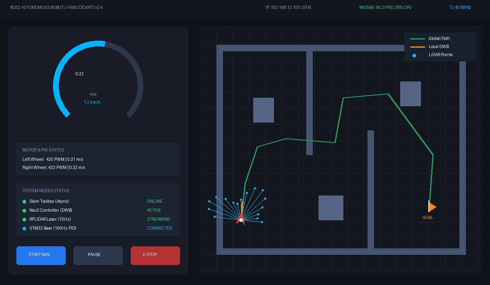
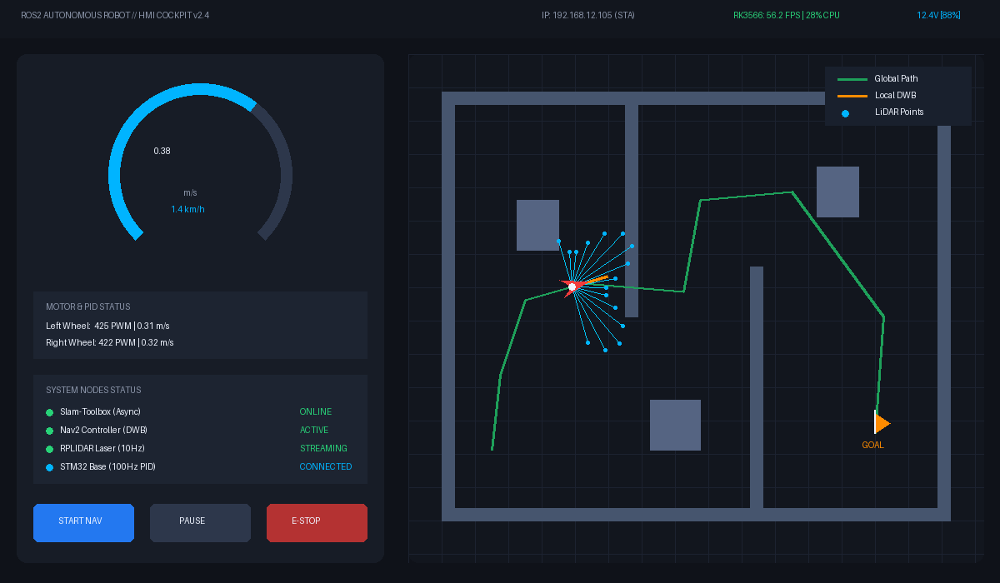
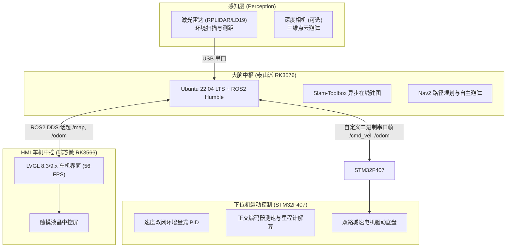

# ROS2 自主导航智能小车 (ROS2 Autonomous Navigation Car)

本项目是一个采用**“算力中枢、车载交互与硬实时运动控制”物理三层解耦架构**的开源移动机器人系统。  
专为高校嵌入式竞赛、ROS2 移动机器人实训以及个人极客自主研发打造，提供全栈可直接复现的软硬件工程。

---

## 🎬 完整实机运行效果演示 (System Demo & Performance)

### 1. 自主导航与动态避障演示 (Dynamic Navigation & Obstacle Avoidance)


### 2. 车载交互中控与高保真 SLAM 建图 (HMI Dashboard & SLAM)


### 3. 核心性能实测指标 (Benchmark Data)
在桌面与实地动态巡航测试中，系统各层表现出色：

| 性能维度 | 实测数据 | 架构优势说明 |
| :--- | :---: | :--- |
| **车机 UI 渲染帧率** | **56 FPS** | 基于 RK3566 硬件 2D/3D 加速运行 LVGL，交互丝滑无卡顿 |
| **交互响应延迟** | **29 ms** | 触控指令至 ROS2 底盘状态刷新近乎实时 |
| **车机 CPU 占用率** | **~30%** | HMI 独立占用，彻底解放泰山派大脑核心算力 |
| **SLAM 栅格建图分辨率** | **0.05 m (5cm)** | Slam-Toolbox 异步建图，边界分明、噪点低 |
| **导航避障频率** | **20 Hz** | DWB 局部规划器根据代价地图高频避开动态障碍物 |
| **直线行驶速度误差** | **< 2%** | STM32 增量式 PID 双闭环抗负载扰动 |

### 3. 完整演示工作流 (Workflow Walkthrough)
1. **开机与状态自检**：
   * 锂电池供电启动，STM32 蜂鸣器自检，编码器归零。
   * 泰山派 RK3576 与 RK3566 通过板载 Wi-Fi/以太网自动组网，ROS2 DDS 节点发现。
   * 车载中控屏启动 LVGL，左侧显示车机仪表、电量与网络状态，右侧初始化地图画布。
2. **激光雷达建图 (SLAM Mapping)**：
   * 启动激光雷达扫描，泰山派运行 `slam_toolbox`。
   * 操作小车在室内巡航一圈，屏幕右侧实时动态渲染 2D 栅格地图（黑色可行走区域、高亮墙体与障碍物）。
3. **Nav2 自主巡航与避障 (Autonomous Navigation)**：
   * 在中控触摸屏地图上轻触目标点（Goal Pose）。
   * 大脑生成全局规划绿线（Global Path），小车自主加速沿路径平滑行驶。
   * 当检测到前方临时行人或障碍物，局部代价地图动态更新，小车平顺变道绕行。

---

## 📸 物理三层解耦系统架构



---

## 🛠️ 硬件清单 (BOM)

| 部件名称 | 推荐型号/规格 | 数量 | 作用说明 |
| :--- | :--- | :---: | :--- |
| **主控大脑** | 泰山派 RK3576 开发板 (4G/8G RAM) | 1 | 运行 ROS2、SLAM 及 Nav2 |
| **交互车机** | 瑞芯微 RK3566 开发板 + 7寸/10.1寸触摸屏 | 1 | 驱动 LVGL 车载中控与地图展示 |
| **下位机主板** | STM32F407ZGT6 / VET6 核心板 | 1 | 电机双闭环控制与编码器采集 |
| **激光雷达** | 思岚 RPLIDAR A1/C1 或 乐动 LD19 | 1 | 360 度室内环境扫描建图 |
| **电机底盘** | 12V 1:30 霍尔编码器减速电机 + 两轮差速机械底盘 | 1 | 动力驱动与底盘运动学支撑 |
| **电机驱动板** | TB6612FNG 或 A4950 驱动模块 | 1 | 驱动双路直流电机 |
| **动力电源** | 3S 航模动力锂电池 (11.1V~12.6V) + DC-DC 降压模块 | 1 | 全系统稳压与动力供给 |

---

## 📂 项目工程目录

```text
ros2-nav-car/
├── README.md                      # 项目主文档
├── docs/                          # 详细硬件接线图与标定手册
│   ├── hardware_wiring.md         # 硬件引脚分配与供电方案
│   └── images/                    # 实机运行效果与仪表盘展示图
├── firmware_stm32/                # 下位机固件源码 (STM32F407)
│   ├── Inc/                       # 头文件 (pid.h, encoder.h, motor.h, protocol.h)
│   └── Src/                       # 电机驱动、正交编码器、PID与串口通信实现
├── ros2_ws/                       # 大脑主控 ROS2 Humble 工作空间
│   └── src/
│       ├── car_bringup/           # 底盘串口驱动节点、一键启动脚本、udev 规则
│       ├── car_description/       # 机器人 URDF 物理模型与 TF 树
│       ├── car_slam/              # Slam-Toolbox 建图配置文件
│       └── car_navigation/        # Nav2 代价地图、路径规划器配置
├── hmi_lvgl/                      # 车机交互工程 (RK3566 / LVGL)
│   ├── src/                       # LVGL 车载仪表盘与 2D 栅格地图绘制组件
│   └── CMakeLists.txt             # Linux 平台构建脚本
└── scripts/                       # 自动化脚本
    └── setup_env.sh               # Ubuntu 22.04 一键安装依赖脚本
```

---

## 🚀 快速上手复现指南

### 1. 下位机固件烧录 (STM32)
1. 使用 Keil MDK 或 STM32CubeIDE 打开 `firmware_stm32/` 工程。
2. 按照 [docs/hardware_wiring.md](docs/hardware_wiring.md) 完成电机驱动与编码器引脚接线。
3. 编译并使用 ST-Link / J-Link 将程序烧录至 STM32F407 核心板。

### 2. 泰山派大脑环境配置
在泰山派 RK3576 (Ubuntu 22.04) 终端执行一键部署脚本：
```bash
cd scripts
chmod +x setup_env.sh
./setup_env.sh
```

### 3. 编译大脑 ROS2 工作空间
```bash
cd ros2_ws
colcon build --symlink-install
source install/setup.bash
```

### 4. 运行建图与自主导航
* **终端 1：唤醒小车底盘与激光雷达**
  ```bash
  ros2 launch car_bringup bringup.launch.py
  ```
* **终端 2：启动 SLAM 在线建图**
  ```bash
  ros2 launch car_slam online_async_slam.launch.py
  ```
* **终端 3：保存地图并启动自主避障导航**
  ```bash
  # 保存建好的地图
  ros2 run nav2_map_server map_saver_cli -f ~/my_map
  # 启动 Nav2 自主导航
  ros2 launch car_navigation navigation.launch.py map:=~/my_map.yaml
  ```

---

## 📄 开源许可证

本项目基于 [Apache License 2.0](LICENSE) 协议开源，欢迎 Star、Fork 并提交 Pull Request！
